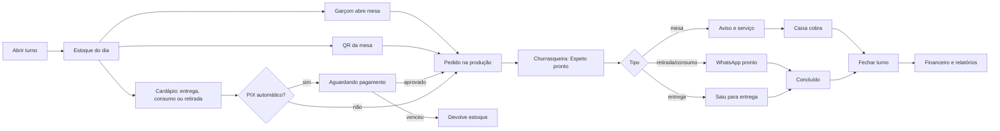

# Auditoria do painel: Fase 1 (mapeamento)

Data: 02/11/2026. Nesta fase nada foi alterado no código. Aguardando aprovação do plano.

> A escolha do arroz no cardápio foi publicada minutos antes de este pedido chegar, e a auditoria já considera esse código.

## Como foi verificado

| Marca | Significado |
|---|---|
| **[medido]** | Medido no sistema real, logado como proprietário, em 360, 768, 1024 e 1440px |
| **[código]** | Lido no código |
| **[banco]** | Consulta de leitura no banco de produção |
| **[não verificado]** | Ainda não confirmado, depende de teste |

**Limites desta fase:**

- O turno está aberto, mas sem mesas nem pedidos. Telas de operação foram medidas **vazias**.
- Cliquei apenas para trocar de tela. Abas internas e janelas (cobrar, fechar turno, cadastro de produto, PIX) **não foram abertas**.
- Não li as 90 telas linha por linha: li a navegação, o cardápio, o garçom, a churrasqueira e as permissões, e fiz varreduras nas demais. A coluna de estados da seção 2.2 mostra o que falta.
- Sem lint: o projeto não tem esse comando em `package.json`.
- Sem prints nos 4 tamanhos: Playwright não tem o login, e o navegador do aplicativo não salva arquivo. As medições acima substituem os prints nesta fase; a Fase 5 precisa de outra forma de captura.

---

## 1. Resumo executivo

1. O painel é funcional e tecnicamente sólido: 14 telas abriram sem erro e sem rolagem lateral nos 4 tamanhos **[medido]**.
2. O maior problema não é o layout, é **a mesma informação em vários lugares**: estoque em 4, impressora em 3, faturamento em 3.
3. O menu tem 13 itens + a aba WhatsApp. Dá para chegar a 10, sem perder função.
4. **Listas sem paginação** são o pior ponto de uso: Auditoria com 14.406px e Produtos com 7.406px em 360px **[medido]**.
5. Permissões estão razoáveis: 26 de 26 tabelas com RLS, e funções sensíveis fechadas ao público **[banco]**.
6. Falta testar os fluxos com pedidos reais: é o maior risco ainda desconhecido.
7. Há regras de negócio frágeis, baseadas no **nome do produto** (combo, arroz, suco, bebidas).
8. A base visual existe (tokens, `Button`, `PageHeader`, `EmptyState`), mas é pouco usada: 409 `<button>` escritos à mão.
9. Sugiro **não** criar um design system do zero nem reescrever o layout: padronizar o que existe é mais barato e mais seguro.
10. Plano: 6 etapas, começando pelo que dá resultado sem risco à operação.

---

## 2. Inventários

### 1.1 Stack **[código]**

| Item | Uso |
|---|---|
| Interface | React 18, TypeScript, Vite, PWA |
| Estilo | Tailwind + tokens em `src/index.css` e `tailwind.config.js`; biblioteca de UI própria em `src/components/ui` |
| Rotas | Próprias, por hash (`App.tsx`), sem biblioteca |
| Estado | Zustand (9 stores; `useTableStore` tem 1.492 linhas) |
| Backend | Supabase: Postgres, RLS, Realtime, Edge Functions |
| Login | Supabase Auth; papéis em `profiles.role` |
| Gráficos | ApexCharts |
| Publicação | Cloudflare Workers |

```text
src/
├─ App.tsx                 rotas e moldura do painel
├─ components/layout/      Header, NavigationTabs, TopTabs, navigation.ts
├─ components/ui/          Button, Dialog, PageHeader, EmptyState, Stepper, OptionGroup...
├─ features/               admin, audit, auth, cashier, delivery, finance, kds, pix,
│                          products, reports, settings, shifts, stock, tables, team,
│                          waiter, whatsapp
├─ stores/                 9 stores Zustand
└─ lib/                    syncService, financeData, formatadores, regras puras
```

### 2.1 Telas

Perfis vêm de `ROLE_TABS` em `navigation.ts`. MASTER e GERENTE têm a mesma lista **[código]**.

| Rota | Arquivo | Objetivo | Dados | Ações principais | Perfis além de Master/Gerente |
|---|---|---|---|---|---|
| `#/painel/visao-geral` | `admin/MasterDashboardView` | Operação agora, sem dinheiro | mesas, pedidos, delivery, estoque | Abrir/fechar turno, novo pedido | Nenhum |
| `#/painel/financeiro` | `finance/FinanceView` | Entradas, saídas, contas | pagamentos, contas | Lançar, exportar, resumo WhatsApp | Nenhum |
| `#/painel/relatorios` | `reports/ReportsView` | Vendas, produtos, garçons, turnos | vendas, turnos | Filtrar, exportar | Nenhum |
| `#/painel/salao` | `waiter/WaiterModule` | Mesas e comandas | mesas, comandas | Abrir mesa, lançar, trocar | Caixa, Garçom |
| `#/painel/mesas` | `waiter/WaiterModule` | **Igual ao Salão** | iguais | iguais | Caixa, Garçom |
| `#/painel/producao` | `kds/KDSModule` | Churrasqueira e cozinha | itens em preparo | Espeto pronto, esgotar | Churrasqueira, Cozinha, Bar |
| `#/painel/caixa` | `cashier/CashierModule` | Fechar contas | comandas, pagamentos | Cobrar, dividir, imprimir | Caixa |
| `#/painel/delivery` | `delivery/DeliveryManagementView` | Pedidos e entregadores | `delivery_orders` | Avançar, cancelar, pagar entregador | Caixa, Entregador |
| `#/painel/cardapio-digital` | `delivery/DigitalMenuQrView` | Link e QR Codes | mesas, configurações | Imprimir, copiar | Caixa |
| `#/painel/whatsapp` | `whatsapp/WhatsAppView` | Conversas e QR | conversas do robô | Responder, conectar | Nenhum |
| `#/painel/produtos` | `products/ProductCatalogManageView` | Cadastro | `products` | Criar, editar, pausar, excluir | Nenhum |
| `#/painel/estoque` | `stock/DailyStockView` | Estoque do turno e sabores | `daily_prep_stock` | Lançar, esgotar, contar | Churrasqueira, Cozinha, Bar |
| `#/painel/auditoria` | `audit/AuditLogView` | Quem fez o quê | `audit_logs` | Filtrar | Nenhum |
| `#/painel/equipe` | `team/TeamManagementView` | Colaboradores | `manage-staff` | Criar, senha, desativar | Nenhum |
| `#/painel/configuracoes` | `settings/SettingsView` | Loja, PIX, entrega, impressão | `restaurant_settings` | Salvar, testar | Nenhum |

Fora do painel: `#/garcom`, `/cardapio`, `#/mesa/<token>`, `#/pedido/<id>`, login.

### 2.2 Funcionalidades

| Funcionalidade | Origem → destino | Regras e validações | Carregando / vazio / erro |
|---|---|---|---|
| Turno | Modal → `shifts`, `daily_prep_stock` | Pedido exige turno aberto, também no banco | Vazio ok; erro **[não verificado]** |
| Pedido de mesa | Garçom → RPC → produção | Estoque na tela (`assertStock`) e no banco; recusado volta ao carrinho | Ok **[código]** |
| Pedido do cardápio | `/cardapio` → `place_delivery_order` | Preço, bairro e estoque validados no banco | Ok **[código]** |
| Pedido por QR | `#/mesa` → `create_table_qr_order` | Limite de 5 pedidos em 10 min | Ok; sem arroz nem observação **[código]** |
| Cobrança | Caixa → RPC | Papéis Master/Gerente/Caixa na tela | **[não verificado]** |
| Produtos | Formulário único → `productSync` | Um só formulário para criar e editar: já bom | Vazio ok |
| Estoque | Estoque, abrir turno, churrasqueira | Combo por gatilho no banco, pelo nome | Vazio ok |
| Financeiro e relatórios | `financeData` | Períodos com exportação | Vazio ok; gráfico vazio com aviso |
| Auditoria | `audit_logs` | Limite de 2.000 linhas **sem aviso** | Sem paginação |
| Equipe | Edge Function `manage-staff` | Master protegido **[código]** | Carregando ok |
| Impressão | `print_queue` → programa local | Falha gera aviso | Aviso impreciso (P4) |
| WhatsApp | Fila + Edge Functions | Robô com modo OFF/TEST/ALL | **[não verificado]** |
| Carregamento geral | 15 textos "Carregando" | Só 3 usos de `animate-pulse`/skeleton | Feedback simples, mas presente |
| Confirmação | `useConfirm` em 7 arquivos | Ações destrutivas usam diálogo | Bom |

### 1.4 Fluxos



Baseado em código e na documentação do projeto. **Nenhum fluxo foi executado de ponta a ponta nesta fase.**

**Permissões:**

- O painel nunca desenha tela fora do papel (`App.tsx:130`), mas isso é na tela. A proteção real é a do banco: RLS em 26/26 tabelas, e `void_tab_atomic`, `cancel_order_item_atomic` e `delete_print_jobs` fechadas ao público **[banco]**. Não conferi as políticas uma a uma nem cada função.
- Churrasqueira, Cozinha e Bar têm as mesmas telas. Quem é da Cozinha pode abrir a aba Churrasqueira e tocar "Espeto pronto" **[código]**. Preciso saber se é desejado.
- O perfil Bar cai em "Churrasqueira" e não tem fila própria. O código diz que é intencional (trabalham pelo cupom).
- A visão pública de configurações entrega `whatsapp_dispatch_url` a qualquer visitante **[banco]**; é só um endereço, mas não precisa estar lá.

---

## 3. Repetições e proposta de consolidação

| # | Repetição | Onde | Proposta |
|---|---|---|---|
| R1 | Salão e "mesas": duas rotas, mesma tela, mesmo título | `App.tsx:215`, `navigation.ts` | Deixar `salao`; `mesas` redireciona |
| R2 | Estoque disponível | Estoque diário; quadro da Visão geral; "Marcar esgotado" na churrasqueira; abrir turno | Estoque é a tela principal; os demais só atalho |
| R3 | Status de impressora | Widget, faixa, `PrintBridgeStatus` | Uma função de saúde e uma faixa; detalhe em Configurações |
| R4 | Faturamento | `ShiftSummaryCard`, Financeiro Visão geral, Relatórios Vendas (mesmos R$ 5.298,00) | Financeiro = dinheiro; Relatórios = análise, sem repetir os cartões |
| R5 | Mesas em atendimento e Produção agora | Visão geral, Salão, Caixa, Produção | Visão geral vira resumo curto com links |
| R6 | Sabores do dia | Abrir turno e Estoque | Um componente só; **confirmar** |
| R7 | Três cardápios | `PublicMenuApp`, `TableOrderPage`, `DeliveryCartDrawer` | QR usa os componentes do cardápio |
| R8 | Controle de quantidade | `Stepper`, `CartItemRow`, `ItemSwapModal`, `WaiterCartDrawer`, `TableOrderPage`, `WaiterOrderPad` | Todos com `Stepper` |
| R9 | Botão "Área do garçom" e "Abrir turno" | Cabeçalho + página + estado vazio (até 3x no Salão) | Só no cabeçalho |
| R10 | Período | `PeriodPicker` + `GroupingPicker` | Manter, com agrupamento só no gráfico |
| R11 | `pad2` copiado | 6 arquivos | `lib/formatters` |
| R12 | `parseMoney` copiado | 3 arquivos | `lib/formatters` |
| R13 | `maskPhone` | `PublicMenuApp`, `inputMasks` | Só `inputMasks` |
| R14 | `const money` e datas | 3 arquivos; 42 formatações de data em 23 arquivos | `formatBRL`, `formatDate` |
| R15 | Regras por papel em texto | `['MASTER','GERENTE','CAIXA']` em vários arquivos | `lib/permissions.ts` |
| R16 | Formulário | **Sem repetição**: `ProductFormModal` já serve para criar e editar | Manter |

**Código morto [código]:**

| Item | Situação |
|---|---|
| `tables/TableGridView.tsx` | Só em teste |
| `kds/BarKDSView.tsx` | Só em teste |
| `delivery/DeliveryCartDrawer.tsx` | Só em teste, após eu apagar o cardápio antigo |
| `ui/StatCard.tsx` | Só em teste |
| `@tanstack/react-query` | Instalada e sem nenhum uso em `src` |

**Estilos:** 312 tamanhos soltos em 51 arquivos; 41 cores fixas em 8 arquivos; 409 `<button>` contra `btn-*` em 47 arquivos. Parte das cores é legítima (cupom, faixas de ponto).

---

## 4. Problemas por severidade

### 🔴 Crítico

| # | Problema | Evidência |
|---|---|---|
| P1 | Todos os combos dependem de um único saldo de "Arroz": com 5, só 5 combos no turno | **[banco]** + função `combo_available` |
| P2 | Combo vende sem o espeto contado: a venda baixa só o arroz, e o espeto fica sem controle (`CONTINUE WHEN NOT FOUND`) | **[banco]** Frango, Suíno, Filé, linguiças |

Regra do P1 pode ser o desejado; o número 5 é que precisa de confirmação.

### 🟠 Alto

| # | Problema | Evidência |
|---|---|---|
| P3 | Combo indisponível aparece à venda no cardápio: o cardápio não usa o campo `available` da mesma forma | **[banco]** Filé-mignon; causa exata **[não verificado]** |
| P4 | Aviso de "cupom que falhou nos últimos 30 minutos" sem falha desde 31/10. O status da impressora também dispara essa frase | **[banco]**, `PrinterStatusWidget.tsx:26` |
| P5 | Auditoria sem paginação, cortada em 2.000 linhas sem avisar | 14.406px em 360px **[medido]**, `auditData.ts:100` |
| P6 | Produtos e Estoque muito longos | 7.406 e 5.554px em 360px **[medido]** |
| P7 | Regras dependem do nome do produto: renomear pode mudar estoque, cupom e categoria | `comboStock`, `categoryOf`, `WaiterOrderPad.tsx:198` |
| P8 | Consumir no local é marcado na observação; link, relatórios e robô tratam como Retirada | **[código]** |
| P9 | Fluxos com pedido não testados nesta auditoria | Limite desta fase |

### 🟡 Médio

| # | Problema | Evidência |
|---|---|---|
| P10 | Em 360px, a faixa + cabeçalho ocupa 145px | **[medido]** |
| P11 | "5 de 5" aparece como "Estoque baixo": alerta sem valor | `LOW_STOCK_THRESHOLD = 5` |
| P12 | Delivery conta "Entregues 3" de outro turno com o turno atual em 0 | **[banco]** |
| P13 | QR Codes: 60 cartões com 5.384px em 360px | **[medido]** |
| P14 | Financeiro e Relatórios têm conteúdo cortado dentro de blocos em 360px (10 e 9 elementos); pode ser rolagem interna | **[medido]**, visual **[não verificado]** |
| P15 | Tabelas: 26 `<table>` em 16 arquivos, 11 rolagens laterais. Vistas nesta medição, nenhuma estava na tela inicial; tabelas em abas e janelas **[não verificado]** | **[código]** |
| P16 | Menu lateral não recolhe no notebook | **[código]** |
| P17 | Telas grandes: `useTableStore` 1.492, `PublicMenuApp` 837, `SettingsView` 687 linhas | **[código]** |
| P18 | Sem dark mode | Sugiro não fazer agora: não é necessidade da operação |

### 🟢 Baixo

| # | Problema | Evidência |
|---|---|---|
| P19 | "Abrir mesa" e "Ver todas" com 40px | **[medido]** nos 3 menores tamanhos |
| P20 | Auditoria com termos técnicos ("abertura turno") | **[medido]** |
| P21 | Termos confusos: "Mise en Place", "SUGESTÕES RÁPIDAS" em maiúsculas | **[medido]** |
| P22 | Em 1440px o conteúdo usa 1182px sem limite ruim | **[medido]**, sem problema real |
| P23 | Dois "Bruno" com o mesmo e-mail; um nunca acessou | **[medido]** |

### Bom, manter

Sem rolagem lateral nas 14 telas nos 4 tamanhos; menu mobile em gaveta; "pular para o conteúdo"; `ErrorBoundary` por tela; confirmação em ações destrutivas; telas carregadas sob demanda.

---

## 5. Nova navegação proposta

**Antes: 13 itens + aba WhatsApp + rota repetida**

```text
Principal: Visão geral · Financeiro · Relatórios
Operação:  Mapa de mesas e comandas · Produção · Caixa · Delivery · Cardápio digital
Controle:  Cadastro de produtos · Estoque diário · Auditoria · Equipe · Configurações
Topo:      Sistema | WhatsApp
```

**Depois: 10 itens + aba WhatsApp**

```text
                Visão geral
Operação:       Salão · Produção · Caixa · Delivery
Cardápio:       Produtos  (abas: Cadastro | Estoque do dia | Cardápio digital)
Gestão:         Financeiro · Relatórios (aba nova: Auditoria)
Administração:  Equipe · Configurações
Topo:           Sistema | WhatsApp
```

| Mudança | Motivo | Cuidado |
|---|---|---|
| "Mapa de mesas e comandas" vira "Salão" | Mesmo nome da página | Nenhum |
| Remove rota `mesas` | Duplicada | Mantém redirecionamento |
| Cadastro, Estoque e QR numa tela com abas | Mesmo assunto | Cozinha e Churrasqueira só veem Estoque; Caixa só QR |
| Auditoria dentro de Relatórios | Consulta, mesmos perfis | Sem perda de acesso |

Na prática, o proprietário ganha menos itens; os outros perfis continuam vendo só o que veem hoje.

---

## 6. Plano de execução

| Etapa | O que faz | Esforço | Risco |
|---|---|---|---|
| 0. Testes reais | 3 pedidos e cobrança, com pedido real, para confirmar P2, P3, P8 e P9 | 1 sessão | Baixo; usa estoque e WhatsApp |
| 1. Correções | P1 a P5, P11, P12, P19 a P21 | 1 a 2 dias | Médio: P2 muda abertura do turno |
| 2. Limpeza | Código morto, `react-query`, R1, R11 a R15 | 1 dia | Baixo |
| 3. Navegação | Seção 5 | 1 a 2 dias | Médio: muda hábito da equipe |
| 4. Listas e telas | Paginação, busca, Produtos, QR, tabelas no celular, R2 a R5, R8, R9 | 3 a 5 dias | Médio |
| 5. Padrão visual | Botões e tamanhos restantes, tela por tela | 3 a 5 dias | Baixo por tela, longo |
| 6. Campo de banco | Consumir no local como tipo real e categoria nas bebidas; regra por campo, não por nome | 2 a 3 dias | Alto: migração, funções e programa de impressão |

Estimativas são aproximadas. Commits pequenos, com testes antes de publicar. Mudança de banco você roda no Supabase.

**O que proponho ajustar no seu pedido:**

- **Layout novo e tokens do zero (Fase 2):** a base já existe e funciona. Proponho completar, não refazer.
- **`DataTable` que vira cards:** só onde a tabela aparecer no celular depois do teste.
- **Dark mode e `Drawer`/`useFetch` genéricos:** deixar de fora; não resolvem problema da operação.
- **Prints antes/depois nos 4 tamanhos:** preciso de uma forma de capturar com login, ou um ambiente com dados de teste.

## Decisões para aprovar

1. O plano e a ordem das etapas.
2. A navegação da seção 5.
3. **P1:** um combo deve mesmo gastar 1 "Arroz" do saldo geral? Qual a quantidade real?
4. **P2:** bloquear combo quando o espeto não tiver quantidade? Recomendo que sim.
5. Cozinha pode tocar "Espeto pronto" da churrasqueira?
6. Sabores do dia ficam em Estoque e também em Abrir turno?
7. Posso fazer os pedidos de teste no número informado? Só fora do movimento.
