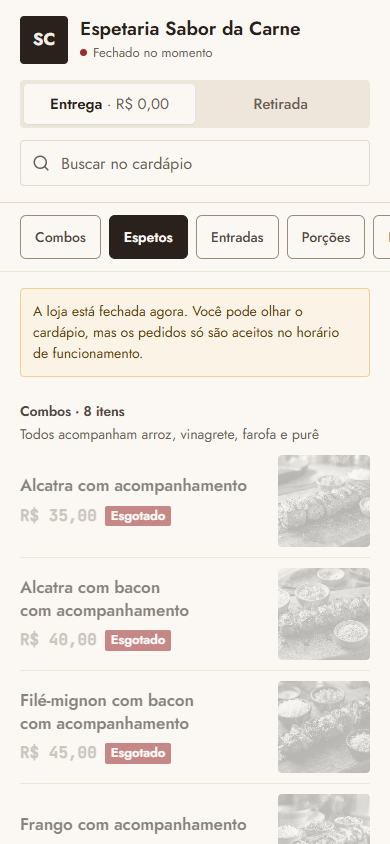
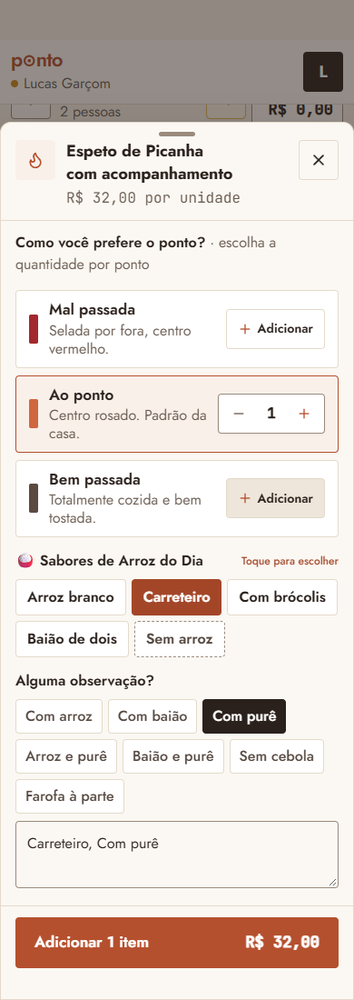
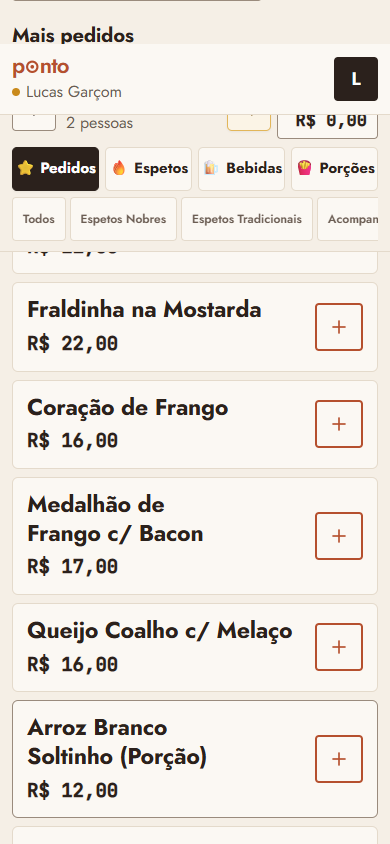

# Auditoria de UX/UI: Ponto (Espetaria Sabor da Carne)

Data: 02/11/2026. Nenhum código do sistema foi alterado. Foram criados só este relatório e a pasta de prints `docs/ux-prints/`.

## Como a análise foi feita

| Fonte | O que cobriu |
|---|---|
| Demonstração local + Playwright (Chrome) | 19 telas em 390px e 1366px, com medição automática de área de toque, contraste, botões sem nome e rolagem lateral |
| Fluxo real do garçom na demonstração | Login, abrir mesa, lançar item, acompanhamentos, carrinho, enviar, conta; também em 320px |
| Cardápio de produção (`sabordacarne.pontopdv.tech/cardapio`) | Só leitura, com a loja fechada. Um item foi tocado no carrinho local; nenhum pedido foi enviado |
| Leitura de código | Cardápio, garçom e churrasqueira completos; varredura de estilos nos 90 arquivos `.tsx` |

### Limites: o que NÃO foi verificado

- **Produção, caixa, delivery e Visão geral com pedidos reais não foram vistos na tela.** A captura com pedidos falhou no meio. Essas telas foram vistas vazias, então a análise delas é mais rasa. Os itens baseados só em código estão marcados com **(código)**.
- **Modais de fechar conta, recibo, fechar turno, cadastro de produto e PIX:** não abertos na tela, exceto "Abrir turno".
- **Tablet (768px):** sem prints. A análise vem dos pontos de quebra no código.
- **Combos na demonstração:** a demonstração não tem produtos "com acompanhamento". Para ver a folha, criei 3 combos temporários na memória do navegador de teste, com sabores de arroz de exemplo. Nada foi gravado. Em produção, a lista de arroz vem das configurações do dia.
- **Pedido pelo QR da mesa:** a demonstração só mostra "QR Code inválido"; o resto é **(código)**.
- **Contraste:** a medição ignora texto dentro de botão desabilitado e fundos com imagem. O "Esgotado" do cardápio foi avaliado a olho.
- **Prints de página inteira:** barras fixas aparecem no meio da imagem (ex.: barra inferior do garçom). Isso é efeito da captura, não defeito.

---

## 1. Resumo executivo: os 10 problemas mais graves

| # | Problema | Onde | Severidade |
|---|---|---|---|
| 1 | **O número da mesa some ao rolar o pedido do garçom.** O cabeçalho cobre "Mesa 03". Medido: cabeçalho vai até 115px e o título fica em 83px. Risco direto de lançar na mesa errada | `index.css:83`, `WaiterPortal` | Crítico |
| 2 | **Faixa vazia de 44px no topo da área do garçom**, reservada para abas que ali não existem. O conteúdo aparece passando por ela (mesma causa do nº 1) | `index.css:83` | Crítico |
| 3 | **Folha de acompanhamentos mistura arroz e observação.** Permite pedir "Sem arroz, Com arroz" ou "Carreteiro, Com arroz". A cozinha recebe texto solto | `WaiterDonenessModal.tsx:39,251-320` | Crítico |
| 4 | **"Ao ponto" já vem marcado e o arroz não é obrigatório.** Com um toque em "Adicionar", o pedido sai sem o garçom ter perguntado nada | `WaiterDonenessModal.tsx:68-72` | Alto |
| 5 | **Bebidas do cardápio: 31 itens numa lista só, sem subgrupos**, com água, gin e refrigerante misturados. No celular o cardápio tem cerca de 7.300px de altura | `PublicMenuApp.tsx` | Alto |
| 6 | **Combos e Espetos repetem os mesmos sabores** em duas seções (8 + 7 itens), com nomes longos e foto igual ou parecida | `PublicMenuApp.tsx:42-44` | Alto |
| 7 | **Título de seção do cardápio menor que o nome do produto** no celular (14px contra 17px) e sem `h1`. A categoria não se destaca durante a rolagem | `PublicMenuApp.tsx:780` | Alto |
| 8 | **Zero com traço da fonte de números parece 8.** Nos prints, "R$ 0,00" lembra "R$ 8,00". Em tela de dinheiro, isso gera erro de leitura | fonte JetBrains Mono, todas as telas | Alto |
| 9 | **Comandos fixos ocupam 30% da tela do garçom** (até 252 de 844px), com 3 níveis de categoria que se repetem | `WaiterOrderPad.tsx:241-305` | Alto |
| 10 | **Sem padrão visual único:** 17 tamanhos de fonte soltos, 6 tipos de canto, 78 cores fixas no código, emojis contra a regra da marca | todo o `src/` | Médio |

**Dois avisos de comportamento** que merecem sua decisão, mesmo não sendo visuais:

- Abrir uma mesa marca como entregues os itens prontos, sem o garçom confirmar (`WaiterOrderPad.tsx:130-135`). Só de olhar a mesa, o aviso de pronto some.
- Na churrasqueira, pedido de mesa sai da tela depois de 30 minutos, sem aviso (`GrillKDSView.tsx:111-117`). Justamente o pedido mais atrasado desaparece. **(código)**

---

## 2. Mapa de telas

| Tela | Rota | Arquivo principal |
|---|---|---|
| Login proprietário | sem sessão | `src/features/auth/LoginScreen.tsx`, `AuthShell.tsx` |
| Login e área do garçom | `#/garcom` | `src/features/waiter/WaiterPortal.tsx` |
| Mesas do garçom / Salão | `#/garcom`, `#/painel/salao` | `src/features/waiter/WaiterModule.tsx` |
| Atalho de mesas | `#/painel/mesas` | `src/features/tables/TableGridView.tsx` |
| Pedido do garçom | dentro da mesa | `WaiterOrderPad.tsx`, `TabItemsPanel.tsx` |
| Folha de ponto e acompanhamentos | dentro do pedido | `WaiterDonenessModal.tsx`, `WaiterSheet.tsx` |
| Carrinho, conta, trocar mesa, trocar item, abrir comanda | dentro do pedido | `WaiterCartDrawer`, `WaiterViewTab`, `TableTransferModal`, `ItemSwapModal`, `WaiterOpenTabSheet` |
| Cardápio do cliente | `/cardapio`, `#/cardapio` | `src/features/delivery/PublicMenuPage.tsx`, `PublicMenuApp.tsx` |
| Pedido pelo QR da mesa | `#/mesa/<token>` | `src/features/delivery/TableOrderPage.tsx` |
| Acompanhar pedido | `#/pedido/<id>` | `PublicOrderTrackingPage.tsx`, `OrderStatusView.tsx` |
| Visão geral | `#/painel/visao-geral` | `src/features/admin/MasterDashboardView.tsx`, `LiveBoard.tsx` |
| Financeiro | `#/painel/financeiro` | `src/features/finance/FinanceView.tsx` |
| Relatórios | `#/painel/relatorios` | `src/features/reports/ReportsView.tsx` |
| Produção | `#/painel/producao` | `src/features/kds/KDSModule.tsx`, `GrillKDSView`, `KitchenKDSView`, `BarKDSView` |
| Caixa | `#/painel/caixa` | `src/features/cashier/CashierModule.tsx`, `TableSettlementModal`, `ReceiptModal` |
| Delivery | `#/painel/delivery` | `DeliveryManagementView.tsx`, `DriverPayoutsView.tsx` |
| Cardápio digital (QR) | `#/painel/cardapio-digital` | `DigitalMenuQrView.tsx`, `TableQrSection.tsx` |
| WhatsApp | `#/painel/whatsapp` | `src/features/whatsapp/WhatsAppView.tsx` |
| Produtos | `#/painel/produtos` | `ProductCatalogManageView.tsx`, `ProductFormModal.tsx` |
| Estoque | `#/painel/estoque` | `DailyStockView.tsx`, `DailyFlavorsManager.tsx` |
| Auditoria | `#/painel/auditoria` | `AuditLogView.tsx` |
| Equipe | `#/painel/equipe` | `TeamManagementView.tsx` |
| Configurações | `#/painel/configuracoes` | `SettingsView.tsx` e cartões em `features/settings` |
| Abrir e fechar turno | modais | `ShiftOpenModal.tsx`, `ShiftCloseModal.tsx` |

Código sem uso em tela: `DeliveryCatalogView.tsx` só aparece em teste. É um segundo cardápio, antigo, que confunde futuras alterações.

### O que já está bom (manter)

- Sem rolagem lateral em nenhuma das 38 capturas, e também sem rolagem no pedido em 320px.
- Zero erro de JavaScript nas telas.
- Contraste do painel e do garçom dentro do AA, exceto os títulos do menu lateral.
- Estados vazios claros, com orientação do que fazer.
- Folha do produto do cliente, que aponta o ponto da carne quando falta.
- "Desfazer" de 4 segundos na churrasqueira e botão "Liberar mesa" para mesa aberta por engano.
- Grade de mesas do garçom: números grandes e fáceis de tocar.

---

## 3. Cardápio digital (análise profunda)

Arquivo: `src/features/delivery/PublicMenuApp.tsx` (808 linhas). Prints: `producao-cardapio-m390-topo.png`, `producao-cardapio-m390-inteiro.png`, `producao-cardapio-d1366-topo.png`, `producao-cardapio-m390-produto.png`.



O cardápio tem boa base técnica: etapas, sacola fixa, validação. A bagunça vem principalmente da **organização do conteúdo**.

| Sev. | Problema | Por que prejudica | Sugestão |
|---|---|---|---|
| Alto | Bebidas: 31 itens sem subgrupos, em ordem sem lógica para o cliente (Água, Caipirinha, Coquetel, Gin, H2O, Long neck, Red Bull...) | Quem quer um refrigerante percorre drinks e doses | Subgrupos: Sem álcool, Cervejas, Drinks, Doses |
| Alto | Combos e Espetos repetem sabores; "com acompanhamento" repetido 8 vezes | O cliente compara duas listas para decidir uma coisa só | Um card por sabor com escolha "Só o espeto / Com acompanhamento" (ver proposta) |
| Alto | Título de seção com 14px, menor que o produto (17px); no notebook são 24px | Sem marcos visuais, a lista parece contínua | Título com 20px e peso 600 também no celular |
| Alto | Loja fechada: todo o estoque aparece como "Esgotado" em cinza | O cardápio parece morto e "esgotado" é falso: o turno só não abriu. **Confirmar com o dono se é o estoque zerado do turno** | Loja fechada: fotos normais, sem "Esgotado", faixa com o horário de abertura |
| Alto | Aviso de erro aparece no topo da lista (`menuError`, linhas 776 e 735) | Quem está no fim da lista não vê que o item não entrou | Usar aviso flutuante perto da barra da sacola |
| Médio | Categoria marcada errada: ao abrir, destaca "Espetos" com "Combos" na tela | A navegação perde credibilidade | Corrigir o acompanhamento da rolagem e marcar a 1ª seção no início |
| Médio | Último chip cortado, sem sinal de que há mais | "Bebidas" pode passar despercebido | Sombra na borda ou nomes mais curtos |
| Médio | Tocar no card adiciona direto, sem confirmação visível, exceto o número sobre a foto | Toque acidental ao rolar coloca item na sacola; tirar exige ir até a sacola | Mostrar `− 1 +` no próprio card depois do primeiro toque |
| Médio | "Entrega · R$ 0,00" no seletor, calculado pelo menor bairro | Promete frete grátis que talvez não exista para o cliente. **Conferir a taxa cadastrada** | "Entrega · a partir de R$ X", ou omitir se for zero |
| Médio | Dá para colocar item na sacola com a loja fechada | O cliente monta o pedido e só depois descobre que não pode enviar | Permitir só olhar, ou deixar claro antes |
| Médio | Fotos iguais ou muito parecidas em vários combos | Foto repetida não ajuda a escolher | Foto própria de cada sabor ou sem foto nos combos |
| Médio | Baixa todas as 57 fotos ao abrir (linhas 287-289) | Gasta dados do celular do cliente | Baixar conforme a rolagem; usar miniatura como no garçom |
| Médio | "Todos acompanham arroz, vinagrete, farofa e purê", mas o cliente não escolhe o arroz, e o garçom escolhe | Mesma venda com regras diferentes. **Decisão do dono** | Definir uma regra só |
| Médio | Tablet usa a coluna do celular (até 1024px, largura máxima 576px) **(código)** | Sobra espaço dos dois lados | 2 colunas a partir de 768px |
| Médio | `ProductSheet` é uma folha própria, sem prender o foco do teclado **(código)** | Quem navega por teclado sai da janela sem perceber | Usar o `Dialog` padrão |
| Baixo | Mobile sem `h1` | Leitores de tela não têm título da página | `h1` com o nome da loja |
| Baixo | Busca sem botão visível de limpar e sem contagem de resultados | Pequeno atrito | Adicionar "X" e "N resultados" |
| Baixo | Seletor Entrega/Retirada com 40px de altura (medido) | Abaixo dos 44px | `min-h-[44px]` |

### Proposta de nova estrutura

**Categorias, nesta ordem:** Espetos · Entradas · Acompanhamentos · Sem álcool · Cervejas · Drinks e doses.

- "Porções" hoje contém Arroz, Vinagrete, Farofa, Purê e Salada: o nome "Acompanhamentos" descreve melhor. "Batata frita" e "Pastéis" já ficam em Entradas.
- "Combos" deixa de ser seção.

```text
CELULAR (390px)
┌──────────────────────────────┐
│ [SC] Espetaria Sabor da Carne│
│ ● Aberto · 40-55 min         │
│ [ Entrega ][ Retirada ]      │
│ 🔍 Buscar                    │
├──────────────────────────────┤  fixo ao rolar
│ Espetos Entradas Acomp. Bebi▸│
├──────────────────────────────┤
│ Espetos                      │  20px
│ Com acompanhamento: arroz,   │
│ vinagrete, farofa e purê     │
│ ┌──────────────────────────┐ │
│ │ Alcatra            [foto]│ │
│ │ Só o espeto    R$ 15  [+]│ │
│ │ Com acomp.     R$ 35  [+]│ │
│ └──────────────────────────┘ │
│ ┌──────────────────────────┐ │
│ │ Vinagrete   R$ 8   [foto]│ │  item simples
│ │                 [− 1 +]  │ │  depois do 1º toque
│ └──────────────────────────┘ │
├──────────────────────────────┤
│ Ver pedido · 2 itens  R$ 43  │  fixo
└──────────────────────────────┘
```

Os preços do desenho são exemplo.

```text
NOTEBOOK (1366px): mantém 3 colunas
┌─────────┬───────────────────────────┬──────────┐
│Categorias│ Espetos (24px)           │ Sua sacola│
│         │ [card] [card]             │          │
│         │ Sem álcool                │          │
└─────────┴───────────────────────────┴──────────┘
```

Para isso funcionar, os combos precisam ser ligados ao espeto. A regra atual é pelo nome, e o cadastro continua igual: dá para juntar "X" e "X com acompanhamento" só na exibição, usando a mesma regra do estoque (`comboStock.ts`). Subgrupos de bebida exigem uma nova informação no cadastro ou categorias novas.

### Pedido pelo QR da mesa (`TableOrderPage.tsx`) **(código)**

| Sev. | Problema | Sugestão |
|---|---|---|
| Alto | Tela separada, sem observação e sem escolha de arroz, que vai para a mesma cozinha | Reaproveitar os componentes do novo cardápio |
| Médio | Mostra a mensagem crua do banco (`rpcError.message`) ao cliente | Traduzir para uma mensagem amigável |
| Médio | Saldo não considera a regra do combo (espeto + arroz), então o erro só vem no envio | Usar `remainingFor` |

---

## 4. Cards de acompanhamentos do garçom (análise profunda)

Arquivo: `src/features/waiter/WaiterDonenessModal.tsx`. Prints: `fluxo-garcom-acomp-1-topo.png`, `fluxo-garcom-acomp-3-selecao.png`, `fluxo-garcom-acomp-4-completa.png`, `fluxo-garcom-acomp-sem-ponto.png`.



**Medições em 390x844:** folha ocupa 832px (quase a tela toda), conteúdo de 753px em área visível de 619px, 18 botões. Todos os 12 chips têm 38 ou 40px de altura, abaixo dos 44px.

| Sev. | Problema | Por que prejudica o garçom |
|---|---|---|
| Crítico | Dois grupos fazem o mesmo trabalho. "Sabores de arroz" e "Alguma observação?" têm Com arroz, Com baião, Arroz e purê... | Dá para marcar "Sem arroz" + "Com arroz". O churrasqueiro e a cozinha recebem a contradição |
| Crítico | Escolhas viram texto dentro da observação; o campo repete "Carreteiro, Com purê" | Apagar o texto desfaz a escolha sem aviso. Não há como contar quantos arrozes de cada tipo saíram |
| Alto | "Ao ponto" já marcado, arroz não obrigatório | Na pressa, sai sem perguntar. O produto do cliente exige escolha; o do garçom, não |
| Alto | Ponto ocupa 3 cards altos com descrição ("Selada por fora, centro vermelho") | O garçom já sabe o que é. São cerca de 270px de tela |
| Alto | 3 espetos em pontos diferentes recebem o mesmo arroz e a mesma observação (`handleDonenessConfirm`) | Mesa com 3 pessoas e arrozes diferentes exige repetir o fluxo, e nada avisa disso |
| Médio | Tocar na linha muda de comportamento: com 1 item troca o ponto; com 2 ou mais soma | O mesmo gesto faz coisas diferentes |
| Médio | Selecionado com 3 estilos: terracota (arroz), preto (observação), âmbar (suco) | Não há um padrão a aprender |
| Médio | Chips com larguras e quebras irregulares, "Farofa à parte" cortado pela rolagem | Visual bagunçado, e as opções abaixo ficam escondidas sem sinal |
| Médio | "Espeto de Coração de frango" sem ponto ainda abre a folha | Passo extra em item que só precisa do arroz |
| Médio | Emoji no título (🍚 🍹), "Toque para escolher" repetido, título "Como você prefere o ponto?" fala com o cliente | Contra a regra da marca e ruído para o garçom |
| Médio | Linhas de ponto são `div` clicável, e os botões de arroz não formam grupo de escolha única para leitores de tela | Acessibilidade |
| Médio | Regras de produto por nome: qualquer item com "arroz" ou "suco" abre a folha (`WaiterOrderPad.tsx:198`) | Um produto novo pode abrir a folha sem motivo. Melhor configurar no cadastro |
| Baixo | Lista de arroz tem valores fixos de reserva (`WaiterDonenessModal.tsx:52`) | Pode mostrar sabor que não existe hoje. Contraria a regra de não ter valores de exemplo no código |

### Proposta: grupos com botões de largura igual

Recomendo **grade de botões em folha que sobe de baixo**, sem chips de largura livre e sem lista com checkbox:

- A grade cabe sem rolagem.
- A posição de cada opção fica fixa, então o garçom memoriza.
- Escolha única fica clara.

```text
┌──────────────────────────────┐
│ Picanha + acomp.   R$ 32  [X]│  linha única
├──────────────────────────────┤
│ Ponto · obrigatório          │
│ ┌────────┬────────┬────────┐ │
│ │  Mal   │  Ao    │  Bem   │ │  48px, escolha única
│ └────────┴────────┴────────┘ │
│ Arroz · obrigatório          │
│ ┌──────────────┬───────────┐ │
│ │ Branco       │ Carreteiro│ │  48px, 2 colunas
│ ├──────────────┼───────────┤ │
│ │ Brócolis     │ Baião     │ │
│ ├──────────────┴───────────┤ │
│ │ Sem arroz                │ │
│ └──────────────────────────┘ │
│ Tirar ou à parte · opcional  │
│ [Sem cebola] [Farofa à parte]│  44px, várias
│ + Escrever observação        │  fechado por padrão
├──────────────────────────────┤
│ [− 1 +]  [Adicionar · R$ 32] │  fixo
└──────────────────────────────┘
```

Altura estimada: cerca de 520px, sem rolagem em 844px.

**Vários espetos diferentes na mesma mesa:** "Adicionar e repetir" adiciona e mantém a folha aberta, zerando as escolhas. Cada espeto vira uma linha própria, e fica fácil diferenciar.

**Estados, sempre iguais em toda a folha:**

| Estado | Aparência |
|---|---|
| Não selecionado | Fundo claro, borda `line-strong`, texto tinta |
| Selecionado | Fundo terracota 500, texto branco, ícone de check (não depender só da cor) |
| Esgotado | Riscado, desabilitado, com "acabou" |
| Faltando | Título em vermelho + "Escolha o ponto", botão rola até o grupo |

```tsx
<OptionGroup title="Arroz" required columns={2} value={rice} onChange={setRice}
  options={riceOptions.map((r) => ({ id: r, label: r }))} />
```

```css
.option { min-height: 48px; border: 1px solid rgb(var(--color-line-strong)); border-radius: 6px; font-weight: 600; }
.option[aria-checked='true'] { background: rgb(var(--color-brand-500)); border-color: rgb(var(--color-brand-500)); color: #fff; }
```

**Decisões necessárias do dono:**

1. O ponto deve ser obrigatório, sem "Ao ponto" pré-marcado? A sugestão acelera menos em um toque, mas evita erro. Alternativa: manter "Ao ponto" como padrão, bem visível.
2. O que é realmente escolha: só o arroz, ou também purê/baião? Hoje a tela do garçom e o cardápio dizem coisas diferentes.
3. Bandeja da cozinha: guardar o arroz em campo próprio permite contar por sabor, mas exige mudar o banco e os cupons. No primeiro passo, dá para manter em `notes` com texto padronizado.

---

## 5. Análise por tela

### Área do garçom: pedido (`WaiterOrderPad.tsx`, `index.css`)
Prints: `fluxo-garcom-rolado-m390.png`, `fluxo-garcom-com-carrinho.png`, `fluxo-garcom-pedido-320.png`.



| Sev. | Problema | Por que prejudica | Sugestão |
|---|---|---|---|
| Crítico | Mesa coberta e faixa vazia no topo. `.app-header` usa `top: 44px` (altura das abas do painel), mas `--app-header-height` só mede 71px | Garçom não vê em qual mesa está lançando | No garçom, zerar a variável (exemplo abaixo). **Testar em 320, 360, 375 e 414px** |
| Alto | 3 níveis: 4 grupos, subcategorias, e "Ver outras categorias" | Área fixa de 30% da tela e caminhos repetidos | Só 4 grupos fixos; subcategoria como títulos na lista |
| Alto | Nome com 23px quebra em até 3 linhas | Menos itens visíveis e mais rolagem. Em combos, poucos cabem na tela | Nome com 18-19px; mostrar "+ acomp." como etiqueta |
| Médio | "⭐ Pedidos" significa "Mais pedidos" | Rótulo enganoso | "Mais pedidos" ou "Top" |
| Médio | "Ocultar fotos" / "⚡ Sem fotos" não deixa claro o estado | Rótulo confuso | Alternador "Fotos: ligado/desligado", nos Ajustes |
| Médio | "Trocar mesa" em âmbar chama mais atenção que tudo, e no celular é só ícone | Ação rara com destaque de alerta | Mover para o menu "Ver conta" |
| Médio | "⚡ Enviar" sem revisão nem desfazer | Rápido (bom), mas um toque errado vai à produção | Faixa de 4s "Enviado. Desfazer", como na churrasqueira, se o banco permitir |
| Médio | Emojis nos grupos e no botão de enviar; `uppercase` em "Ver outras categorias" | Contra a regra da marca, e em cada aparelho o emoji muda | Ícones `lucide` e texto normal |

```css
/* Exemplo do conserto do item crítico */
.waiter-portal { --app-topbar-height: 0px; }
```

### Área do garçom: mesas (`WaiterModule.tsx`)
Print: `fluxo-garcom-mesas.png`, `garcom-m390.png`.

| Sev. | Problema | Sugestão |
|---|---|---|
| Médio | Com "Todas" selecionado, 60 mesas verdes iguais: a legenda ocupa 2 linhas e "Livre" fica sozinha | Legenda em uma linha ou só em Ajustes |
| Médio | Aviso de demonstração cortado pela faixa do topo (mesma causa do crítico) | Resolvido pelo conserto |
| Baixo | Abas Proprietário/Garçom no login com 40px (medido) | `min-h-[44px]` |

### Login (`AuthShell.tsx`, `LoginScreen.tsx`, `WaiterPortal.tsx`)
Prints: `garcom-m390.png`, `garcom-d1366.png`.

| Sev. | Problema | Sugestão |
|---|---|---|
| Baixo | Abas com 40px | 44px |
| Baixo | Painel da marca no desktop: nome da loja, slogan e descrição com contraste 4,29:1 (medido, ou seja, um pouco abaixo dos 4,5 do AA; o fundo pode ser imagem, então confirmar a olho) | Clarear o texto |

### Cabeçalho e menu do painel (`Header.tsx`, `NavigationTabs.tsx`, `TopTabs.tsx`, `PrinterStatusWidget.tsx`)
Prints: `salao-d1366.png`, `visao-geral-m390.png`.

| Sev. | Problema | Por que prejudica | Sugestão |
|---|---|---|---|
| Alto | Celular: título cortado ("Visão ...", "Produ...", "Delivery" como "Deliv...") | A pessoa não sabe onde está | Tirar do cabeçalho, já que a página repete o título |
| Alto | Impressão offline aparece duas vezes (selo e faixa vermelha), em toda tela, cortada no celular | Ocupa 60px em todas as telas, e o alerta constante perde força | Uma faixa só, que pode ser dispensada por um tempo |
| Médio | Desktop: 12 itens de menu com 41px (medido) | Com mouse é aceitável, mas tablet sofre | 44px |
| Médio | Rótulos "Principal/Operação/Controle" com contraste 3,58:1 (medido; AA pede 4,5) | Pouca leitura | Clarear o texto |
| Médio | Menu "Mapa de mesas e comandas" abre página "Salão" | Dois nomes para o mesmo lugar | "Salão" em tudo |
| Médio | "Área do garçom" e "Abrir turno" duplicados na mesma tela do Salão (até 3 vezes) | Poluição | Só uma ação de cada |
| Baixo | "Abrir mesa" fica desabilitado sem dizer o motivo | O usuário não sabe o que fazer para liberar | Texto "abra o turno primeiro" |

### Visão geral (`MasterDashboardView.tsx`, `LiveBoard.tsx`)
Print: `visao-geral-m390.png`. Vista apenas sem pedidos.

| Sev. | Problema | Sugestão |
|---|---|---|
| Médio | Celular: página de 2.539px, com 3 caixas vazias grandes | Caixa vazia compacta, de uma linha |
| Médio | 6 botões sem nome para leitor de tela (medido) | Conferir e adicionar `aria-label` |
| Médio | Abas Todos/Salão/Delivery/Retirada com 36px (medido) | 44px |
| Médio | "Novo pedido" ativo com turno fechado, ao lado de "Abrir turno" | Mostrar só "Abrir turno" |

### Produção (`KDSModule.tsx`, `GrillKDSView.tsx`, `KitchenKDSView.tsx`, `BarKDSView.tsx`)
Print: `producao-m390.png`. Vista só vazia; **cartões com pedido (código)**.

| Sev. | Problema | Sugestão |
|---|---|---|
| Alto | Pedido de mesa some da tela após 30 minutos sem aviso | Manter em vermelho, com "Tirar da tela" manual. **Decisão do dono** |
| Médio | Cor fixa `#f87152` no cartão, com texto branco: contraste estimado abaixo do AA **(código)** | Usar `brand-500` |
| Médio | Tela para usar à distância: conferir tamanho do texto em cozinha real | Testar com pedidos na loja |
| Baixo | Botão de som só com ícone | Mostrar "Som ligado/desligado" |

### Caixa (`CashierModule.tsx`, `TableSettlementModal.tsx`, `ReceiptModal.tsx`)
Print: `caixa-d1366.png`. Modal de pagamento não aberto.

| Sev. | Problema | Sugestão |
|---|---|---|
| Alto | Zero com traço parece 8 em valores | Ver mini design system |
| Médio | Quatro formas de pagamento com quadrado de cor e ícone sem significado de estado | Só ícone e valor |
| Médio | Aba "Em atendimento" selecionada, mas "Conta solicitada" é a prioridade do caixa | Ordem e seleção automática para contas pedidas |
| Médio | `TableSettlementModal` tem 680 linhas e `ReceiptModal` tem 13 usos de texto de 9 a 11px; pode ser do cupom impresso **(código)** | Conferir em teste de uso |

### Delivery (`DeliveryManagementView.tsx`, `DriverPayoutsView.tsx`)
Print: `delivery-m390.png`. Vista só vazia.

| Sev. | Problema | Sugestão |
|---|---|---|
| Médio | 2 níveis de abas somando 6 botões que quebram em 2 linhas | Rolagem lateral das etapas, com contagem |
| Médio | Contagem "0" com zero de traço | Fonte de números |

### Financeiro e Relatórios (`FinanceView.tsx`, `ReportsView.tsx`)
Prints: `financeiro-d1366.png`, `financeiro-m390.png`, `relatorios-*.png`.

| Sev. | Problema | Sugestão |
|---|---|---|
| Médio | Período aparece duas vezes (seletor + datas), e Dia/Semana/Mês/Ano é outro controle | Um só controle; agrupamento só no gráfico |
| Médio | Gráfico vazio ocupa cerca de 300px em vez de um estado vazio | Mostrar "Sem movimento no período" |
| Médio | Seletor Dia/Semana/Mês/Ano com 36px no celular (medido) | 44px |

### Produtos (`ProductCatalogManageView.tsx`, `ProductFormModal.tsx`)
Print: `produtos-m390.png`.

| Sev. | Problema | Sugestão |
|---|---|---|
| Médio | "Restaurar padrões" ao lado de "Novo produto", com o mesmo peso | Mover para o menu "..." com confirmação |
| Médio | Cada linha repete Pausar/Editar/... e fica muito alta no celular | Tocar na linha edita; ações ficam em "..." |
| Médio | Ícones por setor no lugar da foto, sem informação nova | Mostrar a foto real quando houver |
| Baixo | Etiqueta "Ativo" repetida em todos | Mostrar só "Pausado" |

### Estoque e Abrir turno (`DailyStockView.tsx`, `ShiftOpenModal.tsx`)
Prints: `estoque-*.png`, `fluxo-abrir-turno-m390.png`.

| Sev. | Problema | Sugestão |
|---|---|---|
| Alto | Abrir turno é uma tela longa, cada produto em cartão alto com -5/+5, e o botão de confirmar só no fim | Linhas compactas e botão fixo. "Repetir último turno" já ajuda bastante: manter em destaque |
| Médio | Só -5/+5, sem ajuste de 1 em 1 | Permitir digitar (já existe) e -1/+1 |
| Médio | Emojis no modal e em `DailyFlavorsManager.tsx:128` | Remover |

### Configurações (`SettingsView.tsx`)
Print: `configuracoes-d1366.png`.

| Sev. | Problema | Sugestão |
|---|---|---|
| Médio | 2 níveis de abas com visuais diferentes (terracota + preto), e abas não selecionadas em branco parecem campos | Lista à esquerda no desktop; um só estilo |
| Médio | Formulário com largura fixa e metade da tela livre | Aceitável; pode usar coluna de ajuda |
| Baixo | `alert()` nativo em `PrinterStatusWidget.tsx:143` e `PrintBridgeStatus.tsx:107` | Usar `notify` |

### Equipe (`TeamManagementView.tsx`)
Print: `equipe-*.png`.

| Sev. | Problema | Sugestão |
|---|---|---|
| Médio | 10 botões sem nome para leitor de tela (medido em 390px) | Conferir e adicionar `aria-label` |

### Auditoria, WhatsApp, Cardápio digital (QR), Acompanhar pedido
Prints: `auditoria-*.png`, `whatsapp-*.png`, `cardapio-qr-*.png`, `pedido-*.png`.

Sem problema grave nas capturas, mas a demonstração não tem dados nem conexão de WhatsApp, então a análise é limitada. Vale revisar com dados reais. Em 390px, nenhuma destas telas teve controle abaixo de 44px.

---

## 6. Consistência geral

Contagem nos 90 arquivos `.tsx`, sem testes:

| Item | Encontrado | Problema |
|---|---|---|
| Tamanhos de fonte soltos (`text-[Npx]`) | 313 usos, 17 tamanhos: 9, 10, 11, 12, 13, 14, 15, 16, 17, 19, 20, 22, 23, 24, 26, 28, 30 | Sem escala |
| Texto de 9 a 11px | 50 usos | Difícil de ler; parte pode ser de cupom impresso |
| Cantos | `rounded-sm` 63, `md` 147, `lg` 75, `xl` 113, `2xl` 78, `full` 36 | A marca pede cantos pequenos |
| Cores fixas no código | 78 | Fora da paleta central |
| Emojis | 13 linhas | A marca diz "sem emojis" |
| Botões | Classes `btn-*`, componente `Button` e botões escritos à mão | 3 formas para a mesma coisa |
| Cardápios | `PublicMenuApp`, `TableOrderPage`, `DeliveryCatalogView` (sem uso) | 3 implementações |
| Seleção | Terracota, preto, âmbar | 3 aparências para "selecionado" |
| Regras pelo nome do produto | "acompanhamento", "arroz", "suco" | Frágil ao cadastrar |

### Mini design system proposto

Aproveita os tokens já existentes em `src/index.css`.

**Cores**

| Uso | Token | Regra |
|---|---|---|
| Ação principal, selecionado | `brand-500` | Único "selecionado" do sistema |
| Fundo, cartão | `canvas`, `surface` | Sem branco solto |
| Texto | `ink`, `ink-secondary`, `ink-muted` | Sem hexadecimal |
| Sucesso / alerta / erro | `emerald-700`, `amber-*`, `rose-700` | Sempre com texto ou ícone; via `statusStyles.ts` |

**Fonte**

| Nome | Tamanho | Uso |
|---|---|---|
| `caption` | 13px | Mínimo em tela |
| `body` | 15px | Texto padrão |
| `body-lg` | 17px | Texto do garçom e nome de produto no cliente |
| `title` | 20px | Título de seção |
| `page` | 24px | Título de página |
| `display` | 30px | Login, valores grandes |

**Números:** trocar o JetBrains Mono em valores por Jost com `font-variant-numeric: tabular-nums` (colunas alinhadas, zero sem traço). Testar lado a lado antes de aplicar.

**Espaço:** só 4, 8, 12, 16, 24 e 32px.

**Cantos:** 6px em botões, campos e cartões; 12px só no topo de folhas; círculo só em avatar e botão "+".

**Botões**

| Tamanho | Altura | Uso |
|---|---|---|
| `md` | 44px | Padrão |
| `lg` | 56px | Ação principal no celular |
| `option` (novo) | 48px | Grupos de escolha |

Estados obrigatórios: normal, hover, ativo, foco visível, desabilitado (com motivo) e carregando ("Enviando...").

**Componentes para criar ou unificar**

- `OptionGroup`: ponto, arroz, sabores, troco, pagamento.
- `Stepper`: hoje há vários, com alturas diferentes.
- `ProductRow`: garçom, cliente e QR.
- `Sheet`: `WaiterSheet` e `ProductSheet` numa só.
- `Tabs`: um estilo por nível, com 44px.

---

## 7. Plano de ação

### Fase 1: consertos rápidos (cerca de 1 dia)

| # | Ação | Impacto | Esforço |
|---|---|---|---|
| 1 | Consertar a mesa escondida e a faixa do topo do garçom | Crítico | Muito baixo |
| 2 | Remover da observação as opções repetidas de arroz (Com arroz, Com baião, Arroz e purê...) | Crítico | Baixo |
| 3 | Título de seção de 20px no celular e `h1` no cardápio | Alto | Muito baixo |
| 4 | Corrigir a categoria marcada ao abrir | Médio | Baixo |
| 5 | Erro do cardápio em aviso flutuante | Alto | Baixo |
| 6 | Trocar emojis por ícones | Médio | Baixo |
| 7 | Levar para 44px: abas, seletor do cardápio, chips | Médio | Baixo |
| 8 | Unificar selo e faixa de impressão; tirar título cortado no celular | Alto | Baixo |
| 9 | Teste da fonte de números e aplicação, se aprovada | Alto | Baixo |

### Fase 2: folha de acompanhamentos e pedido do garçom (2 a 3 dias)

1. Criar `OptionGroup` e refazer a folha conforme a seção 4.
2. Aplicar suas decisões sobre ponto obrigatório e arroz.
3. Reduzir categorias a um nível; nome de produto menor.
4. Testar em 320, 360, 375 e 414px, e com um garçom real na loja, se possível.

### Fase 3: cardápio digital novo (3 a 5 dias)

1. Reorganizar categorias e subgrupos de bebida (cadastro).
2. Card único por sabor (espeto + opção com acompanhamento).
3. Estado "loja fechada" sem "Esgotado".
4. `− 1 +` no card, fotos sob demanda, 2 colunas no tablet.
5. Levar os mesmos componentes para o QR da mesa; apagar `DeliveryCatalogView.tsx`.

### Fase 4: design system e telas do painel (1 a 2 semanas, em partes)

1. Escala de fonte e cantos; cores fixas para tokens.
2. Componentes únicos (`Tabs`, `Stepper`, `Sheet`).
3. Compactar Abrir turno e Produtos; simplificar período do Financeiro e abas de Configurações.
4. Corrigir nomes para leitor de tela e foco de teclado.
5. Revisar Produção, Caixa e Delivery **com pedidos reais**, que esta auditoria não cobriu.

---

## Correções a este relatório (02/11, durante a implementação)

- **Cantos:** a contagem de "6 tipos" exagerou. O `tailwind.config.js` já limita tudo a 3-6px, então não havia problema real.
- **"Restaurar padrões":** só aparece na demonstração, não na loja. O item de Produtos não vale.
- **Botões sem nome (Equipe e Visão geral):** eram botões dentro de painéis fechados, que a medição leu sem texto. Falso alarme.

## Prints

Todos em `docs/ux-prints/`:

- `<tela>-m390.png`, `<tela>-d1366.png`: as 19 telas.
- `fluxo-garcom-*.png`: fluxo do garçom.
- `producao-cardapio-*.png`: cardápio real (loja fechada).
- `fluxo-abrir-turno-m390.png`, `fluxo-produtos-d1366.png`.

Antes do próximo envio ao GitHub, decida se a pasta `docs/ux-prints/` entra no repositório, que é público, ou fica só no seu computador.
